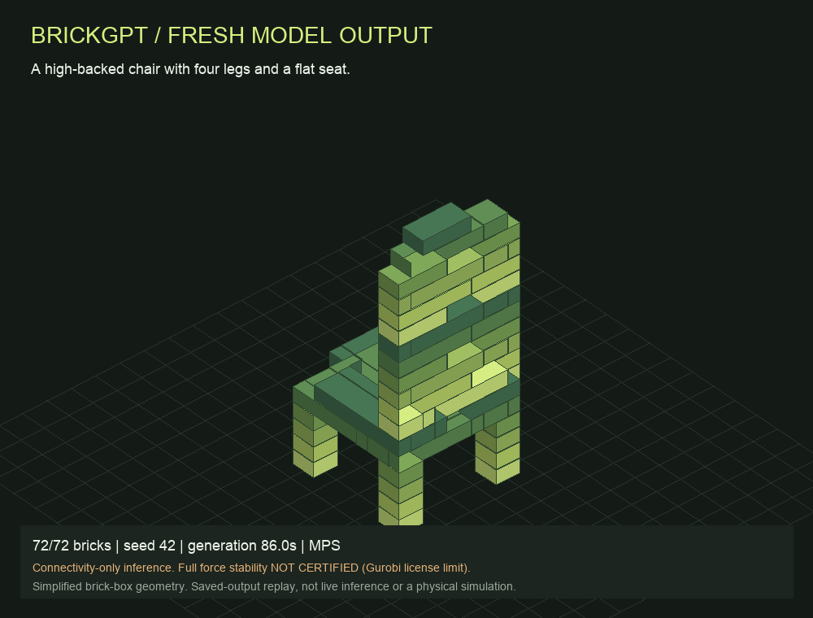

# BrickGPT · Generation lab

A clean local classroom interface for **text-to-brick generation** with the official
[BrickGPT](https://avalovelace1.github.io/BrickGPT/) model (Pun et al., ICCV 2025).
Enter a prompt, watch decoded bricks appear, rotate the result, inspect assembly order,
and export TXT, LDraw, JSON, GLB or a saved-output MP4.



## Try the saved demo first — no model download required

Requires Python 3.10+ for **replay only**. Clone this repository, then run:

```sh
git clone https://github.com/chao-hsiao/brickgpt-demo.git
cd brickgpt-demo
python3 demo/server.py --replay-only
```

Open **http://127.0.0.1:8765/**. Select the chair, click **Replay assembly**, drag to
rotate and use the slider to inspect individual construction stages. Both saved runs,
their output files and their 12-second videos are included. The server binds only to
this computer; the GitHub repository is source/data hosting, not a hosted inference site.

## Install for fresh generation

Use **Python 3.12**, Git and approximately 8 GB free disk. The tested generation
environment is macOS on an Apple M4 Pro with 24 GB unified memory, using MPS.
CUDA and CPU device selection are implemented but have not been tested here.
Windows users should use WSL2; the runner uses a POSIX timeout signal.

1. Obtain approved access to [Llama-3.2-1B-Instruct](https://huggingface.co/meta-llama/Llama-3.2-1B-Instruct).
2. Authenticate locally with `huggingface-cli login` in an environment containing
   `huggingface-hub`, or provide `HUGGING_FACE_TOKEN` / `HF_TOKEN` in your shell.
   Enter credentials privately; do not put them in repository files or issue comments.
3. Run:

```sh
PYTHON=python3.12 bash install.sh
./demo.sh
```

The installer creates `.venv`, installs the pinned direct dependencies, fetches the
fixed official source and downloads about 2.5 GB of official weights to `models/`.
It stops if an existing upstream checkout has edits or a different revision.
It does not accept gated-model terms on your behalf. Model access must already be approved.
For NVIDIA-specific PyTorch builds, prepare `.venv` with the appropriate PyTorch
2.7.0 build before installing the remaining requirements.

After setup, generation uses the local cache in offline mode. Start with:

```text
A high-backed chair with four legs and a flat seat.
```

Use seed `42`. More prompts are in [demo/demo_prompts.txt](demo/demo_prompts.txt).
New runs and logs are saved locally and ignored by Git. FFmpeg is optional: without
it, generation still works and preview/GLB export is available, but no new MP4 is made.
On macOS, the included `Start Demo.command` launches the same server.

### Optional controls

```sh
./demo.sh --port 8766
./demo.sh --device mps
./demo.sh --device cuda
./demo.sh --device cpu
```

Fresh generation requires the installed ML environment, pinned source and downloaded
weights. Otherwise the server automatically offers saved-output replay only.

## Model identity

| Component | Official repository | Pinned revision |
|---|---|---|
| Base | `meta-llama/Llama-3.2-1B-Instruct` | `9213176726f574b556790deb65791e0c5aa438b6` |
| LoRA adapter | `AvaLovelace/BrickGPT` | `19737def7bfe5950b2a466825ad7c6d74b7eafe3` |
| Generator source | `AvaLovelace1/BrickGPT` | `da01aab83f646a700e2270b66b4c00180523448b` |

The adapter is the authors' released BrickGPT checkpoint, not a model trained by this
project. A separate local adapter configuration redirects the base path to the cached
snapshot; weights are not modified. The interface shows the base and adapter names
from the selected run's metadata, with separate loading/generation/replay labels.

## What this demo checks

**This version uses the official connectivity fallback (`use_gurobi=False`). It does
not reproduce the paper's full force-based stability loop.** It checks grid bounds,
collisions and connection to the ground. Connectivity is not force/torque equilibrium.
It may roll back for connectivity; this must not be described as force-based rollback.
`max_regenerations` is bounded to 10 instead of the upstream default of 100.

The runner also attempts the genuine Gurobi static check after generation and records
the verdict or error separately. On the tested machine, the restricted license rejects
the model size (error 10010); the saved outputs are **not certified force-stable**.

Our teammate's [HiGHS demo](https://github.com/sauramt/brickgpt-demo) provides a
different backend for force analysis and rollback comparisons. That backend has **not
been integrated or independently validated in this interface**. When presenting the
two versions, distinguish their hardware, runs and verification modes.

The viewer and GLB show simplified brick boxes at the LDraw ratio 20:20:24, with small
visual gaps. Studs, cavities and the official Blender/FlashTex renderer are omitted.
Assembly replay visualizes saved model output; it is not live inference at replay
speed, a physical collapse simulation or a destruction experiment.

## Included genuine model runs

| Prompt | Seed | Bricks | Generation | Rejections | Geometry / connectivity |
|---|---:|---:|---:|---:|---|
| High-backed chair with four legs and a flat seat | 42 | 72 | 86.01 s | 45 | pass / pass |
| Small stool with a square seat and four short legs | 42 | 72 | 70.48 s | 0 | pass / pass |

Both used MPS float32, ended with EOS and required no rollback. Times exclude loading.
The stool acquired a chair-like backrest: it is retained as a **semantic mismatch**,
not an accurate stool success. Two examples do not establish model quality or
reproduce the paper's benchmark. Identical seeds may differ across devices/versions.
See each run's `result.json`, `trace.jsonl` and original decoded `bricks.txt`.

## Development and verification

```sh
python3 -m unittest discover -s tests -v
```

These standard-library tests cover saved-output/API behavior, file boundaries and
replay-mode generation refusal; they do not substitute for model-quality or physics tests.
See the [verification snapshot](docs/validation.md) for the clean-export check and
a fresh inference run of this packaged runner.
Dependencies are isolated in `.venv`. SciPy 1.17.1 avoids the native PROPACK loader
failure observed with SciPy 1.15.3 on the tested macOS environment.

## Credits and licenses

Classroom interface: Chao Hsiao. Paper, model, dataset and generator: Ava Pun,
Kangle Deng, Ruixuan Liu, Deva Ramanan, Changliu Liu and Jun-Yan Zhu,
*Generating Physically Stable and Buildable Brick Structures from Text*, ICCV 2025.
[Paper](https://arxiv.org/abs/2505.05469) · [Official code](https://github.com/AvaLovelace1/BrickGPT)
· [Official model](https://huggingface.co/AvaLovelace/BrickGPT).

This wrapper is MIT licensed. Upstream code retains its own MIT license; Llama model
weights remain subject to the Llama 3.2 Community License and applicable usage policy.
No model weights, credentials, private course documents or local environment files
are distributed here. This project is not affiliated with or endorsed by LEGO.
