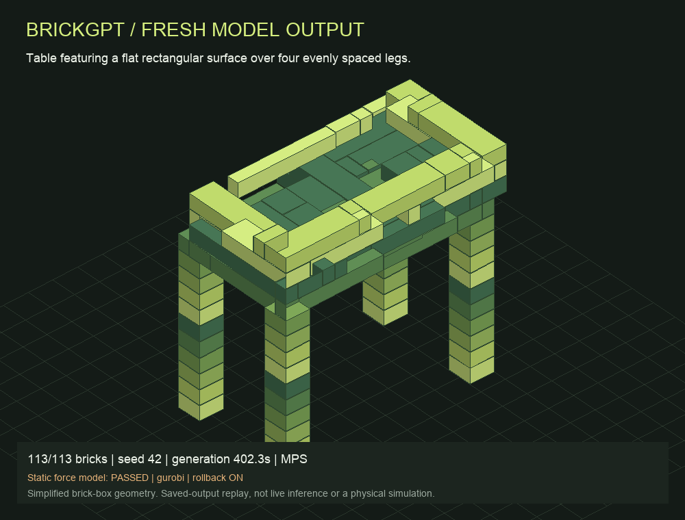
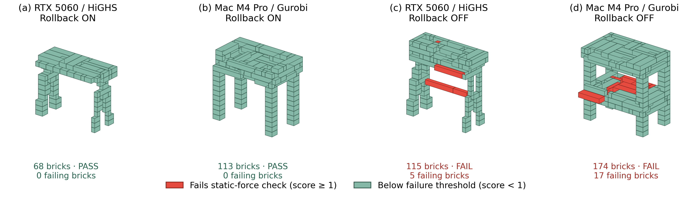

# BrickGPT · Generation lab

A clean local classroom interface for **text-to-brick generation** with the official
[BrickGPT](https://avalovelace1.github.io/BrickGPT/) model (Pun et al., ICCV 2025).
Enter a prompt, watch decoded bricks appear, rotate the result, inspect assembly order,
and export TXT, LDraw, JSON, GLB or a saved-output MP4.

**New generation defaults to the authors' full static-force loop with Gurobi:**
placement rejection, completed-structure force analysis and up to 100 physics-aware
rollbacks. Disable rollback for the ablation. An explicitly labeled HiGHS replacement
from our teammate is optional; legacy connectivity-only runs remain labeled.

## Demonstration setup and result

The demonstration runs on a **Mac with an Apple M4 Pro and 24 GB unified memory**,
using MPS float32. It combines **Llama-3.2-1B-Instruct** with the authors' released
**BrickGPT LoRA adapter**, and uses **Gurobi 13.0.3** for static force/torque checks
and physics-informed rollback.

For the paper's table prompt with seed 42, the full pipeline produced a
**113-brick structure that passed geometry and static stability checks**, after
one physics-informed rollback. Generation took 402.26 seconds, excluding loading.
This is the Mac/Gurobi demonstration; our teammate's RTX 5060/HiGHS experiment
uses a separate hardware and solver configuration.



## Report media: table replay and Figure 6

[Watch or download the rollback-on table MP4](docs/media/table-rollback-on.mp4)
(12 seconds, H.264). This is an **assembly replay of the completed 113-brick Mac/Gurobi
output**, corresponding to panel (b) below. It is not a recording of live inference
or of the rollback operation. The run used seed 42, passed static-force checks and
performed one rollback from 174 bricks to a stable prefix of 3, then regenerated.



[Download the full-resolution Figure 6 PNG](docs/media/figure6-force-colours.png).
Red marks bricks whose maximum voxel force score is **at least 1**, the generator's
failure threshold. The rollback-off RTX and Mac layouts have 5 and 17 failing bricks,
respectively; both rollback-on layouts have zero. The four panels share camera and
axis limits. See [media provenance](docs/media/README.md) for exact sources and prompt.

## Try the saved demo first — no model download required

Requires Python 3.10+ for **replay only**. Clone this repository, then run:

```sh
git clone https://github.com/chao-hsiao/brickgpt-demo.git
cd brickgpt-demo
python3 demo/server.py --replay-only
```

Open **http://127.0.0.1:8765/**. Select the 113-brick Gurobi table, click
**Replay assembly**, drag to rotate and use the slider to inspect construction stages.
Use **Before rollback / After rollback** to compare the draft and final structure.
The saved runs, output files and replay videos are included. The server binds only to
this computer; the GitHub repository is source/data hosting, not a hosted inference site.

## Install for fresh generation

Use **Python 3.12**, Git and approximately 8 GB free disk. The tested generation
environment is macOS on an Apple M4 Pro with 24 GB unified memory, using MPS.
CUDA and CPU device selection are implemented but have not been tested here.
Windows users should use WSL2; the runner uses a POSIX timeout signal.

1. Obtain approved access to [Llama-3.2-1B-Instruct](https://huggingface.co/meta-llama/Llama-3.2-1B-Instruct).
2. Authenticate locally with `huggingface-cli login` in an environment containing
   `huggingface-hub`, or provide `HUGGING_FACE_TOKEN` / `HF_TOKEN` in your shell.
   Enter credentials privately; do not put them in repository files or issue comments.
3. Run:

```sh
PYTHON=python3.12 bash install.sh
./demo.sh
```

The installer creates `.venv`, installs the pinned direct dependencies, fetches the
fixed official source and downloads about 2.5 GB of official weights to `models/`.
It stops if an existing upstream checkout has edits or a different revision.
It does not accept gated-model terms on your behalf. Model access must already be approved.
For NVIDIA-specific PyTorch builds, prepare `.venv` with the appropriate PyTorch
2.7.0 build before installing the remaining requirements.

After setup, generation uses the local cache in offline mode. Start with:

```text
A high-backed chair with four legs and a flat seat.
```

Use seed `42`. More prompts are in [demo/demo_prompts.txt](demo/demo_prompts.txt).
New runs and logs are saved locally and ignored by Git. FFmpeg is optional: without
it, generation still works and preview/GLB export is available, but no new MP4 is made.
On macOS, the included `Start Demo.command` launches the same server.

### Optional controls

```sh
./demo.sh --port 8766
./demo.sh --device mps
./demo.sh --device cuda
./demo.sh --device cpu
```

Fresh generation requires the installed ML environment, pinned source and downloaded
weights. Otherwise the server automatically offers saved-output replay only.

## Model identity

| Component | Official repository | Pinned revision |
|---|---|---|
| Base | `meta-llama/Llama-3.2-1B-Instruct` | `9213176726f574b556790deb65791e0c5aa438b6` |
| LoRA adapter | `AvaLovelace/BrickGPT` | `19737def7bfe5950b2a466825ad7c6d74b7eafe3` |
| Generator source | `AvaLovelace1/BrickGPT` | `da01aab83f646a700e2270b66b4c00180523448b` |

Tested Gurobi is 13.0.3; the official repository's `uv.lock` pins 12.0.2. This
interface follows the original source and force model, rather than claiming a
bit-identical software environment or reproduction of every paper figure.

The adapter is the authors' released BrickGPT checkpoint, not a model trained by this
project. A separate local adapter configuration redirects the base path to the cached
snapshot; weights are not modified. The interface shows the base and adapter names
from the selected run's metadata, with separate loading/generation/replay labels.

## Static physics and rollback

The default is **Gurobi**, the solver used by the paper and official implementation.
The model weights, token masking, rejection sampling, force/torque formulation and
prefix-pruning algorithm are the official source at the pinned commit. Default
`use_gurobi=True`, `max_regenerations=100`, temperature 0.6 and world size 20 are
preserved. There is a 900-second classroom wall-clock guard.

A completed draft is checked for static stability. If it fails, the original loop
removes bricks starting at its first unstable brick until a stable prefix remains,
then continues generation. The UI records both rejected proposals and rollback
transitions, e.g. `174→21`; it shows final per-brick force scores on request.
Turning **Physics-informed rollback** off preserves the first draft and still runs
final force analysis, allowing a stable/unstable comparison with the same seed.

### Gurobi setup

Obtain and activate a valid Gurobi license on **your own machine** before generation.
Eligible students can request a free, full-featured academic Named-User license for
coursework. Gurobi requires a recognised academic network at initial activation;
afterward Named-User operation can be offline. See the
[official academic license instructions](https://support.gurobi.com/hc/en-us/articles/360040541251-How-do-I-obtain-a-free-academic-license).
The runner verifies solver access before loading the language model. Force-analysis
errors are reported explicitly. Never upload `gurobi.lic` or activation keys.

### Optional HiGHS backend

Our teammate's [HiGHS demo](https://github.com/sauramt/brickgpt-demo) replaces the
solver through a linear reformulation. Its attributed backend is included unmodified
under `demo/vendor`, pinned at commit `90d6efee0183b2360950340e3c82f83b4f6056e1`.
Our separate wrapper audits the raw solution against the original equality, absolute
value, maximum and complementarity constraints before accepting it (tolerance 1e-8;
the backend snaps magnitudes below 1e-9 to zero). This is a solver replacement,
**not the original solver**, and not a claim of identical outputs on every input.
Select it explicitly in the interface; no paid license is needed for HiGHS.

The original 13 geometry/stability tests pass with both backends on the tested Mac.
In an additional solver comparison, 25 cases had solutions from both backends,
of which 21 verdicts agreed. The four
exceptions were ground-level pairs, where Gurobi retained equilibrium residuals of
4.99e-10 to 2.67e-9 and the original strict `>0` rule reported failure. The teammate's
historical counts differ; do not present these as the same experiment or universal
proof of equivalence.

### Scope

A passing result means **the implemented static assembly model passes**. It is not
an impact/fracture simulation or a guarantee about a physical construction. The
viewer and GLB use simplified boxes at the LDraw ratio 20:20:24, omitting studs and
cavities. The authors' Blender/LDraw/FlashTex rendering pipeline, texture synthesis,
robot control and physical assembly have not been reproduced by this interface.
Assembly replay visualizes a saved decoded sequence, not real-time inference.

The interactive preview uses WebGL depth testing to keep overlapping brick faces
in the correct order during rotation. Dragging pauses automatic rotation. If
WebGL is unavailable, an offscreen Canvas 2D fallback provides a simpler preview;
its face ordering is approximate.

## Original Gurobi demo evidence

| Stage of the same real model run | Bricks | Static force result |
|---|---:|---|
| Initial draft, at first EOS | 174 | failed |
| Final output after one physics rollback (174→3) | 113 | passed |

Prompt: `Table featuring a flat rectangular surface over four evenly spaced legs.`
Seed 42; Apple MPS float32; Gurobi 13.0.3; official weights/source pins above.
Full generation took 402.26 seconds, loading excluded. This is a single example,
not the authors' hardware timing or benchmark. The initial 174-brick draft is
extracted from the **same full inference trace**, not a separately sampled second
inference. The UI explicitly labels it and links **Before rollback / After rollback**.
Fresh independent rollback-off generation is also available with the checkbox.

New completed full-mode runs that actually roll back automatically save their own
initial draft and enable **Before rollback / After rollback**. These buttons switch
between saved stages of the same inference; they do not trigger a rollback or run
the model again. Runs with rollback disabled, or no rollback needed, have no pair;
hover over the disabled button for the reason. To recover an older complete run
with a saved trace, use the installed ML/solver environment:

```sh
.venv/bin/python demo/comparison.py demo/runs/<run-id>
```

This reconstructs the draft from that run's trace and rechecks its force scores
without loading the language model. It preserves the final generated structure.

Both stages have actual Gurobi force scores, decoded layouts, geometry and replay
assets. The historical connectivity-only chair/stool examples below retain their
original provenance and force status; they are not force-validated results.

## Historical connectivity-only examples

| Prompt | Seed | Bricks | Generation | Rejections | Geometry / connectivity |
|---|---:|---:|---:|---:|---|
| High-backed chair with four legs and a flat seat | 42 | 72 | 86.01 s | 45 | pass / pass |
| Small stool with a square seat and four short legs | 42 | 72 | 70.48 s | 0 | pass / pass |

These older runs used connectivity-only inference, MPS float32, ended with EOS and
required no rollback. Static force stability is not certified for these examples.
Times exclude loading.
The stool acquired a chair-like backrest: it is retained as a **semantic mismatch**,
not an accurate stool success. Two examples do not establish model quality or
reproduce the paper's benchmark. Identical seeds may differ across devices/versions.
See each run's `result.json`, `trace.jsonl` and original decoded `bricks.txt`.

## Development and verification

```sh
python3 -m unittest discover -s tests -v
```

The standard-library tests cover saved-output/API behavior, file boundaries and
replay-mode generation refusal. Optional real-solver tests run when the official
source and ML/solver packages are installed. These include a connected but force-
unstable stack and the original stable-prefix rollback method; they do not substitute
for a generation benchmark or physical assembly.
See the [verification snapshot](docs/validation.md) for the clean-export check and
a fresh inference run of this packaged runner.
Dependencies are isolated in `.venv`. SciPy 1.17.1 avoids the native PROPACK loader
failure observed with SciPy 1.15.3 on the tested macOS environment.

## Credits and licenses

Classroom interface: Chao Hsiao. Paper, model, dataset and generator: Ava Pun,
Kangle Deng, Ruixuan Liu, Deva Ramanan, Changliu Liu and Jun-Yan Zhu,
*Generating Physically Stable and Buildable Brick Structures from Text*, ICCV 2025.
[Paper](https://arxiv.org/abs/2505.05469) · [Official code](https://github.com/AvaLovelace1/BrickGPT)
· [Official model](https://huggingface.co/AvaLovelace/BrickGPT).

This wrapper is MIT licensed. The vendored HiGHS adapter retains Group 8's MIT
notice in `demo/vendor/TEAMMATE_LICENSE.txt`. Upstream code retains its own MIT license; Llama model
weights remain subject to the Llama 3.2 Community License and applicable usage policy.
No model weights, credentials, private course documents or local environment files
are distributed here. This project is not affiliated with or endorsed by LEGO.
